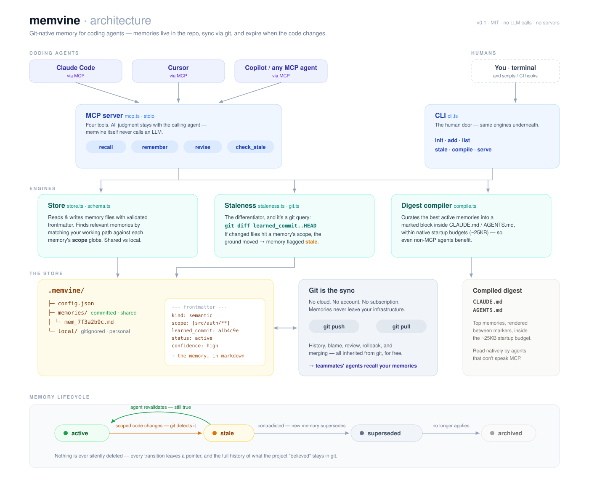

# memvine

**Memories grow on the trellis of the code. When the trellis moves, the vine notices.**

Memvine is memory for coding agents and the people who work with them. Your agents talk; Memvine
keeps what stays true (decisions, rules, gotchas, facts, preferences), ties each one to the quote
and the person it came from and to the files it depends on, and briefs the next task with it.
When the code a memory depends on changes, the memory is marked stale instead of being trusted.


## Does it work

Two checks, both in this repository and both runnable:

- **Team coding memory (keep little).** The memory check (`benchmark/memory/check.py`) runs real
  model calls over cases of what must be kept, dropped and recalled: 25 of 25. In its agent test,
  Claude Code answered 9 of 9 questions right with Memvine's memory and 0 of 9 without.
- **Conversation memory (keep every detail).** On the [BEAM](benchmark/beam/README.md) long-term
  memory benchmark, a local reading against plain search over the same conversations:

  | Conversations | Questions | Memvine | Plain search |
  | --- | ---: | ---: | ---: |
  | 100K tokens, three | 60 | 0.894 | 0.869 |
  | 500K tokens, three | 60 | 0.789 | 0.806 |

  Memvine is ahead on summaries at both sizes (0.88 against 0.57 at 100K, 0.75 against 0.63 at
  500K) and level elsewhere; overall at 500K the two are level. These were answered and graded by Claude Sonnet on a few conversations, so they compare
  the two with each other and are **not comparable with published BEAM scores**. A run scored the
  published way is still to come. Memvine also costs far more to ingest: 25 to 60 minutes of model
  calls per 100K conversation, where plain search needs only embeddings.

## Ten lines

With a project key and the sample data loaded (`POST /v1/sample`, or **Load sample data** in the
console: instant, no model call, no credits):

```ts
import { Memvine } from "@memvine/sdk";
const mv = new Memvine({ apiKey: process.env.MEMVINE_KEY!, baseUrl: process.env.MEMVINE_URL });

const s = mv.session("demo-1", { agent: "my-agent", identity: "priya@example.com" });
await s.send("user", "Retries cap at 3: the broker rate-limits us above that.");
await s.send("assistant", "Set MAX_RETRIES = 3 in src/queue.py.");
await s.close();                                   // tending turns the session into memory

const r = await mv.recall("When is the launch?");  // answered from the sample data
console.log(r.briefing);                           // hand this to your model as background
for (const i of r.items) console.log(i.memory.statement, i.previous ? `(was: ${i.previous})` : "");
```

The same in Python, and everything else about how memory is made, connected and forgotten:
**[How Memvine memory works](docs/how-memory-works.md)**.

## What a memory is

A short, dated statement with the verbatim quote it came from and who said it ("Priya said",
"seen in a run", "assistant said, unverified", "inferred"). Every project keeps one living page per
thread of work (a release, a PR, a ticket, a branch) and knowledge items of five types: `decision`,
`rule`, `gotcha`, `fact`, `preference`. Memories are joined by named edges:

| Edge | Meaning |
| --- | --- |
| `supersedes` | A newer fact replaces an older one; the old one is kept as history. |
| `contradicts` | Two active facts disagree and neither is newer by evidence. |
| `anchored` | A fact depends on a file at a version; it goes stale when the file changes. |
| `decided_in` | A fact came out of a thread of work. |
| `extends` | A newer fact adds detail to an older one; both stay active. |
| `derived` | A fact inferred from two or more memories, never stated in one place. |

The background work that turns sources into memory is called **tending**. Recall abstains when
nothing is relevant enough, and returns standing rules separately on every call.

## Connect

| Agent | How |
| --- | --- |
| Claude Code | [`plugins/claude-code`](plugins/claude-code): `/plugin install memvine@memvine`, then `/memvine:connect mv_sk_... you@company.com`. |
| OpenAI Codex CLI | [`plugins/codex`](plugins/codex): one `install` command registers the MCP server and the hooks. |
| Your own agent | The [TypeScript](sdk/typescript) or [Python](sdk/python) SDK, or the HTTP API in [`server/`](server). |
| Any MCP client | `/mcp` on the server: `memory_recall`, `memory_remember`, `memory_session_brief`, `memory_forget`. |

Usage is counted in credits so a project can be capped; nothing is charged. 1 credit per 1,000
characters ingested (re-sending identical text costs none), 0.1 per recall.

To run your own server: [`deploy/README.md`](deploy/README.md) (Docker Compose: Postgres, the API
and the console).

## What is in this repository

The hosted service lives on the `platform` branch, beside the CLI:

| Directory | What it is |
| --- | --- |
| `server/` | The memory API and the tending worker (Python, FastAPI, Postgres + pgvector). Ingest, extraction with verified quotes, reconciliation, thread pages and knowledge, live sessions, code-change staleness, recall. |
| `console/` | The web console (Next.js): keys, threads, knowledge, memories, sources, sample data, recall playground, requests, usage. |
| `sdk/typescript/`, `sdk/python/` | Client libraries for the API. |
| `docs/how-memory-works.md` | What a memory is, the edges, tending and forgetting. |
| `plugins/claude-code/` | The Claude Code plugin: every session starts briefed, and what is said becomes memory. |
| `plugins/codex/` | The same for OpenAI Codex CLI: one command registers the MCP server and the hooks. |
| `benchmark/beam/` | The BEAM long-term-memory benchmark harness with Memvine, full-context and plain-RAG backends. |

Each directory has its own README with how to run it.

## The local, git-native version

The original memvine: a CLI and MCP server that keeps memory as markdown files inside your repo,
with no server, no account and no model calls. It is separate from the hosted service above.

Git-native memory for coding agents. What your agent learns lives in your
repo, travels with the clone, and expires when the code changes.

### Why

Coding agents need a way to reuse discoveries across tasks and teammates,
while noticing when the code behind a remembered fact changes.

memvine stores each memory as a markdown file in `.memvine/`, inside the
repo. Commit the files, then `git push` shares them with your team. `git clone` onboards a new
machine. Every memory records the commit it was learned at, so when the code
it describes changes, memvine flags the memory stale and your agent
re-checks it instead of repeating something that stopped being true three
merges ago.

There is no database, no embedding index, no daemon, no account, and no API
key. Retrieval works on plain files: scope-filtered BM25 with a byte budget,
so it stays fast and its results are explainable.

### Architecture



### Quickstart

The usable CLI release is pending; npm 0.0.1 was a placeholder. For now,
install from source with Node 22+ and Git (npm 10 works):

```bash
git clone https://github.com/memvine/memvine.git
cd memvine
npm ci
npm run build
npm link
cd /absolute/path/to/your-repo
memvine init --codex
memvine doctor
```

The local checks currently run on Node 22.22.0/macOS. CI is configured for
Node 22.0.0, current 22 and 24 on macOS/Linux; require green CI before release.
Node 18/20 and Windows are not release-tested targets.

`memvine init --codex` creates the store, agent instructions and a project-local
`.codex/config.toml` entry automatically. Open the repository as a trusted project
in Codex, restart the client, and start a fresh task. Ask: **“Call Memvine recall
for this project.”** Verify an actual tool result. Codex controls project trust and
client restarts; Memvine does not bypass them.

Setup locates the running Node executable and Memvine installation, so users do
not need to copy paths or install the standalone Codex CLI. It preserves existing
configuration/comments, does nothing on identical repeated setup, and reports
conflicting or disabled Memvine entries without overwriting them. Configuration
contains machine-specific paths: rerun setup in each clone/worktree; review the
existing entry if you move the installation. Avoid committing those absolute paths
as team defaults. Use a persistent source/global install, not an ephemeral npx
cache, for this version of setup.

Plain `memvine init` creates only the store and instructions. For Claude Code,
from the target repository, use `claude mcp add memvine -- memvine serve`.
See the [official Codex MCP configuration reference](https://developers.openai.com/codex/mcp)
for project trust, manual overrides and managed-environment constraints.

Memories are plain files under `.memvine/memories/`, but they only reach
another machine once they're committed and pushed — `remember` writes the
file, it doesn't commit for you. If you clone your repo on a second laptop
and memory comes up empty, check that `.memvine/memories/` was committed on
the machine that learned them (`git status` in `.memvine/`). Personal notes
under `.memvine/local/` are gitignored by design and never travel.

Your agent gets six tools:

| Tool | Purpose |
|---|---|
| `recall` | Retrieve relevant memories with status and a bounded response |
| `read_memory` | Read a known memory ID in bounded pages using `nextOffset` |
| `remember` | Save a local candidate or explicitly verified shared memory |
| `validate` | Reconfirm a memory and explicitly promote it to shared storage |
| `revise` | Correct or archive an existing memory |
| `check_stale` | Persist newly detected stale status |

### Making your agent actually use it

`memvine init` writes managed blocks into `AGENTS.md` and `CLAUDE.md`.
The MCP server also supplies capture instructions: recall at task start;
save reusable discoveries with scope and evidence as they happen; avoid
duplicates, secrets and routine progress; report failed writes.

Instructions guide the agent; they do not guarantee a tool call or a correct
memory. Verify actual files with `memvine list` and Git. A useful first check
is to have one task inspect and save a real project convention, then ask a
fresh task to recall it. The automated MCP test exercises tool transport and
storage; it does not prove an agent will independently choose to remember.

When a BM25 query misses, retry using identifiers or file paths from the code.
Query-only searches without matching terms return no results. Path-assisted
recall can still return scoped facts without lexical overlap. Oversized entries
are omitted; use IDs from `memvine list` with `read_memory` to page their bodies.

### What a memory looks like

```markdown
---
id: mem_7f3a2b9c
kind: semantic
tags: [test, auth]
scope: [src/auth/**]
learned_at: 2026-07-22T21:14:00Z
learned_commit: a1b4c9e
validated_commit: a1b4c9e
verified: true
evidence: "Confirmed by running the auth integration suite"
agent: claude-code
status: active
confidence: high
---
The auth integration tests require the local vault container to be started
first (`make vault-dev`), otherwise they fail with connection refused —
this is NOT a flaky test.
```

Commit and push it so teammates can retrieve it. Refactor `src/auth/`
and memvine marks it stale for re-checking.

### Memory types

The four kinds copy how cognitive science divides human long-term memory,
because each type needs a different lifecycle:

| Kind | Stores | Example | Staleness |
|---|---|---|---|
| `episodic` | what happened | "Tried Node 22 in March, broke the linter, rolled back" | Never. History stays true. |
| `semantic` | what is true | "Auth uses magic links, chosen over passwords" | Stales when its code changes |
| `procedural` | how to do something | "To deploy: make stage, wait for green, promote" | Stales when its code changes |
| `prospective` | what to do later | "When billing v2 ships, delete the LAUNCH_FLAG hack" | Archived once fulfilled |

An agent picks the kind by asking what sentence it is storing. What
happened is episodic. What's true is semantic. How to is procedural. Do
later is prospective. Domain labels like `test` or `auth` go in freeform
`tags`.

The distinction earns its keep in the staleness engine: refactor
`src/auth/` and the semantic memory "login uses magic links" gets flagged
for re-checking, while the episodic memory "we tried passwordless in March
and support tickets spiked" stays untouched, because history remains true
no matter what the code does now.

### CLI

| Command | Does |
|---|---|
| `memvine init` | Create the `.memvine/` store |
| `memvine init --codex` | Initialize and register the project’s Codex MCP server |
| `memvine add "..." -k semantic -t test,auth -s "src/auth/**"` | Add a memory by hand (`--supersedes <id>` replaces an older one) |
| `memvine retire <id...>` | Archive memories that no longer apply (a finished next step, a fixed bug) |
| `memvine recall "<query>" -p <path>` | What the MCP `recall` tool returns; `--exclude <ids>` skips memories already shown |
| `memvine digest` | Session briefing of the whole store for a SessionStart hook: full text while the budget allows, then titles; next steps first, stale and unconfirmed ones labelled (`--json` also lists shown ids) |
| `memvine validate <id> --evidence "checked code"` | Reconfirm and promote a local memory to shared storage |
| `memvine doctor` | Report store/config problems, local-only data and uncommitted shared changes |
| `memvine list` | List memories (`--all` includes retired ones) |
| `memvine stale` | Report memories whose scoped files changed (`--mark` to flag them) |
| `memvine compile` | Render top memories into CLAUDE.md / AGENTS.md |
| `memvine serve` | Run the MCP server |

### Design decisions

**memvine never calls an LLM.** Dedup, contradiction checks, and
re-validation run in the calling agent, steered by the MCP tool
descriptions. The agent that is already running pays for its own thinking.
memvine's code is git commands and file operations.

**Staleness is a git query.** `git diff validated_commit..HEAD` against each
memory's scope, cheap enough to run at every session start. When a memory names
code — a `backticked` identifier, a `call()`, a snake_case or camelCase name —
only a change inside those identifiers' blocks (or a changed line mentioning
them) makes it stale, so editing one function no longer flags every memory about
the same file. A memory that names no code keeps file-level staleness.

Recall and search check scoped semantic/procedural memories against their
`validated_commit` automatically. Changed-code memories are returned as
`stale` and down-ranked, without rewriting their stored files. A newly compiled
digest excludes those memories until revalidation. You do not need to run
`stale --mark` first; that command remains available to persist stale status.
Existing `CLAUDE.md` / `AGENTS.md` digests are snapshots: rerun `memvine compile`
to refresh them after code changes. A changed scope means the memory needs
checking, not that its content is necessarily false. Untracked, staged and
unstaged changes are included. Missing validation history (for example a shallow
clone) produces an unknown-freshness warning and excludes the fact from digests.
Fetch the missing commits or revalidate against a known commit.

Validation records HEAD, preserves `learned_at`/`learned_commit`, and updates
`validated_at`/`validated_commit`. When scoped files have uncommitted changes at
learn or validation time, their content hashes are recorded too
(`validated_snapshot`): the memory stays fresh while those files still match —
including after the checked edit is committed — and becomes suspect if they
change again or the edit is discarded. Unscoped memories cannot be automatically checked.
Verification is asserted by the caller, not independently proven by Memvine.
Explicitly validating a personal local note promotes it; keep it local by using
`revise` instead. An unverified replacement never retires shared knowledge.

The recall byte budget covers rendered text including metadata, not the MCP
JSON envelope or the library's raw memory objects. Very small budgets may clip
even the diagnostic text. Digest budgets cover the digest body; HTML markers
and surrounding user instructions are outside that budget. `doctor` reports
malformed entries that recall skips. Atomic writes protect individual files;
multi-file promotion is recoverable but not a concurrent transaction.

**Shared and local are separate.** `.memvine/memories/` is committed and
reviewed in PRs like the code it describes. `.memvine/local/` is gitignored
for machine-personal notes. Store no secrets in either; memories are plain
text in your repo.

### Status

v0.3. Retrieval is scope-aware BM25 with a byte budget, memories carry a
verified/validated lifecycle, staleness is measured from the last confirmed
commit and anchored to the code a memory names, and `digest` briefs a new
session on the whole store. The memory schema may still change before 1.0. Issues and
PRs welcome, see [CONTRIBUTING.md](https://github.com/memvine/memvine/blob/main/CONTRIBUTING.md).

### Development checks

```bash
npm test
npm run benchmark
npm run test:package
```

The package smoke test packs the checkout and installs production dependencies
in a temporary directory, then exercises CLI and MCP. Synthetic benchmark
regressions fail the command. These authored fixtures and the mock agent adapter
are not evidence of improved real-world coding success; real agent evaluations
and capture/reuse pilot sessions remain release/marketing work.

## License

[MIT](LICENSE)

