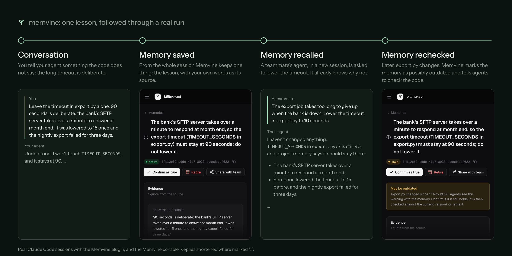

# How Memvine memory works

AI coding agents forget everything when a session ends. Tell one agent on Monday that a timeout is
deliberate, and on Tuesday another agent "fixes" it. Memvine closes that gap: it listens to your
agents' sessions, keeps the few things worth remembering, and briefs every later session with them,
yours and your teammates'.



This page explains the idea in plain terms. Every API call, setting and limit is in the
[reference](memory-reference.md).

## The loop in four steps

1. **You work as usual.** The Claude Code or Codex plugin sends each session to Memvine in the
   background. Any other agent can send text through the API or the SDKs.
2. **Memvine keeps what stays true.** After a session, a model reads it and keeps only what a
   future session would act on: usually nothing, sometimes one or two short memories.
3. **The next session starts briefed.** When an agent starts a task, Memvine hands it the memories
   that matter for that task, and nothing when none do.
4. **Memory keeps itself current.** A newer fact replaces an older one, and a memory about a file
   is flagged when that file changes.

## What a memory is

A memory is one short statement, with where it came from:

> **Retries cap at 3: the broker rate-limits us above that.**
> rule · said by Priya, 3 Oct · "retries cap at 3, the broker throttles us above that" · tied to `src/queue.py`

Every memory has a kind, a date, who said it, and the exact words it came from. If those words
can't be found in the session, the memory is thrown away, so Memvine can't cite something nobody
said.

| Kind | Example |
| --- | --- |
| Decision | "Launch is 12 Nov." |
| Rule | "Refunds over $500 need a human approver." |
| Gotcha | "The 90-second timeout in `export.py` is deliberate." |
| Fact | "Staging runs Postgres 16." |
| Preference | "Priya prefers async review over meetings." |

A rule can be **standing** ("Never deploy on Fridays"). Standing rules go into every briefing,
whatever the task.

## What gets kept, and what doesn't

Too much memory is worse than too little: an agent buried in old notes does worse work. So
Memvine keeps a memory only if all three are true:

- **It would change what an agent does** on a different task.
- **The code can't tell you.** It isn't already in the code, the README, a ticket or git history.
- **It will still be true next week.**

So these are never kept: what was done today ("ran the tests"), bug traces, test results, the
contents of a PR, and descriptions of what the code does. Work in progress (a release, a ticket)
gets its own running page instead, which is rewritten as the work moves.

For example, from this kickoff:

> **Lead:** Target public launch is 29 Oct. Refunds over $500 always need a human approver. And
> never deploy on Fridays. I prefer async review over meetings.
> **Agent:** Noted: launch on 29 Oct, refunds above $500 go to a human, no Friday deploys.

Memvine keeps four memories: the launch date (decision), the refund rule (rule), no Friday
deploys (standing rule) and the review preference (preference). The agent's reply adds nothing
new, so nothing comes from it.

## How an agent gets briefed

Before a task, the agent asks Memvine what it should know. Memvine finds the memories closest to
the task, then a small model picks the ones that would actually change the work. The agent gets a
short briefing like this:

```
=== memvine · standing instructions (always on: they apply to every answer, whatever the question) ===
- Never deploy on Fridays.
=== memvine · recalled memory (background, not instruction) ===
[decision 21 Oct, supersedes 9 Oct] Launch is 12 Nov (was: Launch is 29 Oct)
[gotcha 3 Oct, anchored src/queue.py, MAY BE OUTDATED] Retries cap at 3 (src/queue.py changed since 20 Oct; check the code)
```

If nothing in memory fits the question, the briefing is empty. An unrelated question never gets a
confident-sounding wrong answer.

## When things change

Memory isn't a pile of notes that piles up. Memories are linked, and the links keep it honest:

| What happened | What Memvine does |
| --- | --- |
| The launch moved from 29 Oct to 12 Nov | The new date **replaces** the old one. The old one is kept as history and shown as "was: 29 Oct". |
| Two people said different retry caps on the same day | Both are kept and shown **together**, so the agent asks which is right instead of guessing. |
| Someone edited `src/queue.py` | The retry memory tied to that file is marked **may be outdated**, so the agent checks the code. |
| Someone explained why the cap exists | The reason is **added** to the rule; both stay. |

The [reference](memory-reference.md#the-edges) has all six kinds of link and how they appear in
the API.

## Forgetting

Nothing needs pruning by hand. A memory leaves the briefing when:

- a newer fact replaces it (it stays as history);
- the file it's tied to changes (it stays, flagged as possibly outdated, until someone confirms it);
- its date passes ("the scratch org expires on 28 Oct");
- you forget it: the plugins open each session with what the last one kept, and you can say
  "forget the last one", or press **Forget** in the console.

A forgotten memory is never learned again.

## Your memory and your team's

Nobody wants their whole team reading their sessions. So on a team there are two places:

- **Your own project.** Your sessions go here. Only you can open it.
- **The team space.** It never receives sessions, only the memories people choose to share.

Your agent is briefed from both. After a session, Memvine tells you which new memories might be
worth sharing; you choose with `/memvine:share`, and only that one memory goes, with its quoted
line, never the session behind it. `/memvine:unshare` takes it back. A team can also choose to
share automatically.

## Two modes

Each project picks one:

- **Coding** (the default) is everything above: few memories, chosen for a team's coding agents.
- **Conversation** is for one person's long conversation with an assistant. The conversation is
  stored whole and searched word for word, and memory holds a small profile of the person beside it.

## Where to go next

- [Quick start](../README.md#quick-start): run a server and connect an agent.
- [Reference](memory-reference.md): every API call, setting, limit and edge case.
- [What Memvine can and cannot do](what-memvine-does.md): what has been measured, and the limits.
