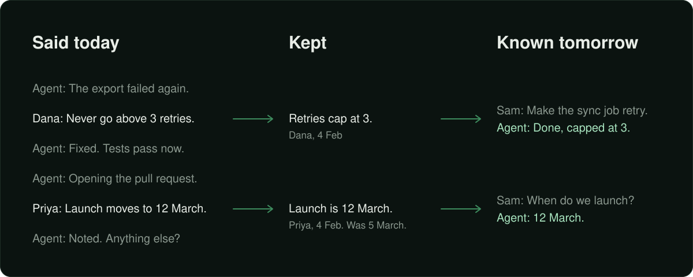

# How Memvine memory works

**Memories grow on the trellis of the code. When the trellis moves, the vine notices.**



Your agents talk. Memvine reads what they say, keeps the parts that stay true, ties each one to
where it came from, and hands the relevant ones back at the start of the next task. A memory is a
short statement (a decision, a rule, a gotcha, a fact, a preference) with a date, a speaker, the
exact quote it came from, and edges to the memories and files it depends on.

## Ten lines

You need a project key (`mv_sk_...`, from the console's **API keys** screen, or
`memvine-server create-project` on your own server) and, to see an answer straight away, the
sample data: the console offers **Load sample data** on an empty project, or

```sh
curl -X POST "$MEMVINE_URL/v1/sample" -H "Authorization: Bearer $MEMVINE_KEY"
```

It loads instantly, with no model call and no credits. Then, in TypeScript (`@memvine/sdk`):

```ts
import { Memvine } from "@memvine/sdk";
const mv = new Memvine({ apiKey: process.env.MEMVINE_KEY!, baseUrl: process.env.MEMVINE_URL });

const s = mv.session("demo-1", { agent: "my-agent", identity: "you@example.com" });
await s.send("user", "Retries cap at 3: the broker rate-limits us above that.");
await s.send("assistant", "Set MAX_RETRIES = 3 in src/queue.py.");
await s.close();                                   // tending turns the session into memory

const r = await mv.recall("When is the launch?");  // answered from the sample data
console.log(r.briefing);                           // hand this to your model as background
for (const i of r.items) console.log(i.memory.statement, i.previous ? `(was: ${i.previous})` : "");
```

Or in Python (`memvine-sdk`):

```python
import os
from memvine_sdk import Memvine
mv = Memvine(os.environ["MEMVINE_KEY"], base_url=os.environ.get("MEMVINE_URL", "https://api.memvine.dev"))

s = mv.session("demo-1", agent="my-agent", identity="you@example.com")
s.send("user", "Retries cap at 3: the broker rate-limits us above that.")
s.send("assistant", "Set MAX_RETRIES = 3 in src/queue.py.")
s.close()                                    # tending turns the session into memory

r = mv.recall("When is the launch?")         # answered from the sample data
print(r.briefing)                            # hand this to your model as background
for i in r.items: print(i["memory"]["statement"], f"(was: {i['previous']})" if i["previous"] else "")
```

Recall prints the current launch date with the old one beside it, because the newer statement
superseded the older one. Two more things recall does that matter on day one:

- **It picks.** Inside a project every memory looks similar to every task, so similarity only finds
  the candidates. A small model reads the question and picks what would change the work (memories,
  and the page of a piece of work the question is about), and only that is served. If the model
  fails or takes too long, recall falls back to the closest matches.
- **It abstains.** If nothing in memory is relevant enough to the question, `abstained` is true and
  the briefing is empty, so an unrelated question never gets a confident-looking wrong answer.
- **Standing rules come separately.** Rules marked standing ("Never deploy on Fridays") come back
  in `standing` on every recall, abstained or not, and head the briefing when it is served.

The session you just sent becomes memory in the background (see Tending); once `GET /v1/jobs`
shows nothing pending, "How many retries?" finds it.

With edges, each recalled memory also carries its neighbours, and any memory's full neighbourhood
is one call away:

```ts
const r = await mv.recall("When is the launch?", { include: { related: true } });
for (const e of r.items[0].related) console.log(e.kind, e.direction, e.statement); // supersedes out "Launch is 29 Oct"
const node = await mv.related(r.items[0].memory.id);   // the node plus every edge, both directions
```

Agents in Claude Code and Codex need no code at all: the plugins in `plugins/claude-code` and
`plugins/codex` brief every session from memory and send what is said.

## Sources and memories

|  | Sources | Memories |
| --- | --- | --- |
| What | The raw text you send: a conversation, a live session's messages, a document. Stored as sent (secrets redacted). | Short, dated statements drawn from sources, each with the verbatim quote it came from. Organized as thread pages for work in progress (one per piece of work) and a small set of durable knowledge items. |
| Examples | A Claude Code session; a standup transcript; a PR thread pasted in. | "Launch is 12 Nov" (decision); "Never deploy on Fridays" (standing rule); "Retries cap at 3" (gotcha, anchored to `src/queue.py`). |
| Who changes it | You. Re-sending an id with the same text is free and changes nothing; new text replaces the source and everything drawn from it. | Tending writes and reconciles them. People confirm one (still true), retire one (forget), or state a correction, which supersedes the old one. |
| Lifecycle | Kept until the project's `retention_days`, then the raw text is dropped and the memories stay. Deleting a source deletes the memories drawn only from it. | Active until superseded (kept as history), stale (its file changed), or retired. |

## The edges

Memories are connected, and the connections have names, spelled the same way in the API,
the console and these docs.


*A leaf is a memory: grey once it has been replaced, dashed when it was inferred.*

| Edge | Meaning |
| --- | --- |
| `supersedes` | A newer fact replaces an older one; the old one keeps its end date. |
| `contradicts` | Two active facts disagree and neither is newer by evidence. |
| `anchored` | A fact depends on a file at a version; it goes stale when the file changes. |
| `decided_in` | A fact came out of a thread of work. |
| `extends` | A newer fact adds detail to an older one; both stay active. |
| `derived` | A fact the model inferred from two or more memories, never stated in one place. |

**`supersedes`.** On 9 Oct the team lead says "launch is 29 Oct"; on 21 Oct they say "we're moving
the launch to 12 Nov". "Launch is 12 Nov" supersedes "Launch is 29 Oct", and recall answers with the
new date and shows the old one as `(was: ...)`.

**`contradicts`.** In two sessions on the same day, one engineer says "retries cap at 3" and
another says "retries cap at 5". Neither is newer by evidence. Both stay active and recall shows them together, so the agent asks
instead of picking one.

**`anchored`.** "Retries cap at 3" was learned in a session that edited `src/queue.py` at
`a1b4c9e`. Someone changes that file; the fact is marked stale and the next brief shows it as
"[gotcha 3 Oct, anchored src/queue.py, MAY BE OUTDATED] Retries cap at 3 (src/queue.py changed
since ...; check the code)", so the agent reads the code instead of trusting the memory.

**`decided_in`.** "Billing is manual for the beta" was decided in the thread for release 0.4. The
thread page lists it under Decisions, and an agent working on that release gets the page and the
decision together.

**`extends`.** "The cap exists because the broker rate-limits" extends "Retries cap at 3". The
second adds the reason without replacing the rule, so both stay active.

**`derived`.** Three sessions show the same person approving partner contracts, answering partner
questions and owning the partner checklist. "Partner onboarding has one owner" is derived from them: stored as
inferred, at low confidence, with links to the memories it came from.

Two more things read like edges but are fields on the memory: **said by** (who said
it, and whether it was seen, stated, claimed or inferred) and **why** (the reason given for a
decision or rule).

Today the first four are fields on every memory (`supersedes` and `superseded_by`,
`conflicts_with`, `stale_reason` with the anchors behind it, `thread_id`).

All six are served as named edges: `GET /v1/memories/{id}/related` returns a memory and every edge
in both directions, `POST /v1/recall` with `include: {related: true}` adds up to six edges to each
recalled memory, and `GET /v1/graph` returns a neighbourhood of facts, threads, files and people
for the console's graph. `extends` and `derived` are written by tending.

The agent sees the same graph. Each line of a recall briefing names its edges in these words,
with the date of the memory at the other end, and quotes that memory where the line needs it:

    [decision 21 Oct, supersedes 9 Oct] Launch is 12 Nov (was: Launch is 29 Oct)
    [rule 21 Oct, contradicts 21 Oct] Retries cap at 5
    [fact 22 Oct, extends 21 Oct] The cap exists because the broker rate-limits (adds to: Retries cap at 3)
    [fact 23 Oct, inferred, derived from 3 memories] Partner onboarding has one owner
    [gotcha 3 Oct, anchored src/queue.py, MAY BE OUTDATED] Retries cap at 3 (src/queue.py changed since 20 Oct 2026; check the code)

A contradiction is quoted once, in a pair at the top of the briefing that asks the agent to say
both and ask which is right; the lines themselves only name it. Trust is said in words where it is
lower than a person or a run: "assistant said, unverified" or "inferred".

### How a memory says who said it

Wherever a memory is shown to a person, its `assertion` reads as words, not a badge:

| `assertion` | Reads as |
| --- | --- |
| `observed` | seen in a run |
| `stated` | the speaker's name, then "said" |
| `claimed` | assistant said, unverified |
| `inferred` | inferred |

An assistant's report on its own work ("all tests pass") is always `claimed`, and counts for half
in recall.

## One transcript becomes many facts

The sample project starts with a six-line kickoff like this one:

```
## Lead · 5 Oct 10:00
Target public launch is 29 Oct.
Refunds over $500 always need a human approver; the support bot may only draft them.
And never deploy on Fridays. I prefer async review over meetings.
## Agent · 5 Oct 10:01
Noted: launch on 29 Oct, refunds above $500 go to a human approver, no Friday deploys, and reviews happen async.
```

It yields four memories, each with the quote that proves it:

| Type | Memory | Quote |
| --- | --- | --- |
| decision | The public launch is planned for 29 Oct. | "Target public launch is 29 Oct." |
| rule | Refunds over $500 always need a human approver; the support bot may only draft them. | "Refunds over $500 always need a human approver" |
| rule, standing | Never deploy on Fridays. | "never deploy on Fridays" |
| preference (low confidence: said once) | The lead prefers async review over meetings. | "I prefer async review over meetings." |

The agent's line adds nothing: it restates what the lead said. A quote that cannot be found in the
source word for word is dropped, so a memory cannot cite something nobody said. A week later,
"Legal pushed back on the refund copy, so we're moving the launch from 29 Oct to 12 Nov" becomes a
new decision that supersedes the first, with its reason as its `why`.

In the console, an empty project opens on a paste box: paste a few lines from a session, a standup
or a PR thread and the facts appear one by one with their edges, within the request
(`POST /v1/ingest` with `instant: true`, for one source under 4,000 characters, billed like any
other).

## Tending

Turning sources into memory runs in the background. Memvine calls this **tending**.

1. **As messages arrive.** Each message of a live session is stored the moment it is sent. Other
   sessions of the project see it straight away, as pending, before anything is extracted.
2. **When a stretch is sealed.** A session is cut into stretches at a completed exchange once
   about 6,000 characters have built up, once the oldest unsealed message is 10 minutes old, and
   when the session closes (or after 30 idle minutes). A source sent with `ingest` is one stretch.
3. **Extraction and reconcile.** For each stretch, one model call rewrites the thread pages it
   touches and a second proposes knowledge items, each with a verbatim quote. Each candidate is then compared with what is
   already known: the same thing (evidence is added), an update (`supersedes`), a contradiction
   (`contradicts`, or `supersedes` when the new evidence is more recent), or something new.
4. **Code checks.** At the start of each session the Claude Code and Codex plugins report the
   current versions of anchored files (`POST /v1/code/check`; any client can call it); memories whose files changed turn stale, and turn active again if the file
   changes back.
5. **Tidy-up (background consolidation).** About daily, or after 20 new memories, a project with at
   least 10 active memories gets a conservative pass over what is already known (paused projects
   never do). Near-identical restatements (same audience, kind and category; cosine 0.92 or more with
   the same numbers and dates) are merged into the stronger one; closer calls, missed updates and
   contradictions (cosine 0.8 or more) go to the fast model in one batched call, at most 50 pairs a
   run. Unreviewed memories a week old and never recalled, and unreviewed facts, are re-asked the
   three tests (at most 30 a run). Doubt only flags a memory for review ("may repeat another", "a
   newer one may replace it", "may no longer be worth keeping", with the reason); a memory a person
   kept or made is never changed, only flagged. Nothing is deleted: a merged memory is retired as
   `merged` and **Un-merge** (PATCH status `active`) brings it back; every action is in the
   Activity feed as `consolidation`. `POST /v1/projects/{slug}/consolidate` runs one now;
   `GET /v1/projects/{slug}/consolidation-runs` lists what each run did.

A memory is visible to recall as soon as its stretch's job is done: `GET /v1/jobs` shows the queue
(the console's **Jobs** page shows the same), and the pending count reaching zero means everything
sent so far is memory.

<!-- landing in workstream 2 -->
The console's header says what tending is doing: "tended 4 min ago · tending 2 sessions".
<!-- /landing in workstream 2 -->

## Memory types and their behavior

| Type | Behavior | Status |
| --- | --- | --- |
| decision | Persists; carries a `why`; `decided_in` a thread. | true today |
| rule | Persists; may be `standing` (always on, every recall). | true today |
| gotcha | Anchored to code; goes stale when the file changes. | true today |
| fact | Persists until superseded; history kept. | true today |
| preference | Strengthens with repetition: each restatement raises confidence. | true today |
| progress | Never a fact. Updates the thread page, then expires. | true today |

A preference said once starts at low confidence and rises one step (low, medium, high) each time
it is restated, with each restatement's quote kept as evidence. Progress is refused as knowledge,
and the State and Next steps items it leaves on a thread page are dropped when the page is next
rewritten, if their newest source is more than 30 days older than the one being written.

### Two modes: coding and conversation

Everything above describes a **coding** project, the default: agent sessions on a codebase, where
memory is read on every task and too much of it is worse than too little. A project can instead be
in **conversation** mode (console: Settings → Memory rules; API: `memory_mode` on
`POST /v1/projects` or `PATCH /v1/projects/{slug}`), for one person talking with an assistant over
time. There the conversation itself is stored whole and searched word for word, and memory is a
small profile of the person beside it:

| | coding | conversation |
|---|---|---|
| What is kept | Durable knowledge that passes the three tests; usually nothing or one item per excerpt | A profile of the person: who they are, the people in their life, goals, plans, limits, preferences, decisions and standing instructions, each the value of a named slot (`constraint/monthly-book-budget`). An item must be about the person, said or decided by them (its quote must come from one of their own turns), and change a later answer. Usually nothing or one item per excerpt; a few dozen for a long conversation |
| Thread pages | One per piece of work | None |
| Progress and states of the moment | Refused | Left to the conversation's own words, except a value the person says has changed, which is always kept. A plan is current until the day it is for |
| Updates and contradictions | Reconciled | By slot, with no similarity search: the extractor reads the whole profile and names the slot of what it keeps. A new value replaces the slot's and the old one stays as history, in the order said; a statement that cannot be true together with the slot's, with no change said, is kept beside it and recall shows both. Only the extractor's "update" for a slot it was shown retires a value. An item about to get a slot of its own is first compared with the lines it most resembles (the fast model): already covered, it only adds evidence to that line; adding something lasting, it is folded into it; otherwise it is new. That check can drop or fold, never replace (`slots.py`) |
| Recall | What the task needs: the fast model picks, and abstains when nothing applies | The standing instructions; then the few profile lines closest to the question (at most `MEMVINE_RECALL_PROFILE_LINES`, within `MEMVINE_RECALL_DETAIL_FACT_SHARE` of the budget), each with its date and the value it replaced, conflicts first as pairs; then the original words: source excerpts found by keyword and by meaning, one passage per turn, so the person's own short turns are not buried in the assistant's long ones. A question asking for a summary is answered from digests instead (below) |
| Recency | Facts and gotchas fade | Nothing fades with age. A profile line old enough that no briefing has served in `MEMVINE_MEMORY_UNUSED_DAYS` ranks lower (`MEMVINE_RECALL_UNUSED_WEIGHT`), so lines that are never the answer drift out of the few a question gets |
| Background consolidation | Merges restatements, links missed updates and contradictions, and flags what fails the three tests | A different pass (below): the whole profile is read at once, and lines about the same thing become one line or a list with its count |

**Consolidation of the profile.** Written an excerpt at a time, a profile ends up with the same thing
spread over several lines: a habit said five ways, each choice of what to read next in a line of its
own. And nothing in a conversation can be counted by searching it: no passage holds "thirteen films
planned so far". So the tidy-up of a conversation project (the same job and schedule as step 5 above,
`profile_consolidation.py`) gives the main model the whole profile and asks for groups:

- a habit, taste or limit said in pieces becomes one line;
- a choice made again and again becomes one line with the current choice first and the earlier ones
  after it;
- the members of a set the person is building up (books finished, features asked for, people
  invited) become a list with its count, under a `list/` slot, which later excerpts add to;
- a plan whose day has passed stops being current.

The lines of a group are retired as merged into the new line, which takes all their evidence, and a
person can un-merge any of them. What the model writes is checked without a model: a group needs two
lines of the profile, a known slot type, a statement of bounded length and, unless it is a list, no
number that none of its lines has. "Today" is the day of the last thing said, so a conversation
imported later is tidied as of its own end. Standing instructions, lines in a recorded conflict and
anything a person kept or wrote are never offered to the model. The pair-by-pair steps of coding-mode
consolidation do not run here: among one person's lines they retired the wrong ones.

Measured on three BEAM conversations (60 questions): the profiles came out a tenth smaller and the
score did not move, 0.863 after against 0.867 before. The questions that need a count across
sessions were not helped. Details in [the plan](plans/conversation-memory-plan.md).

**Digests, for summaries.** A question such as "summarize how the project went" resembles no single
detail, so the points a good answer needs rank hundreds deep in any search. In conversation mode the
fast model therefore writes a digest of each excerpt as it is synthesized: about forty words naming
what was worked on, the problem, and what was decided. Every four consecutive digests are rolled up
into one, and those again, so a conversation of any length has a cover that fits a briefing. A
summary question gets that cover in time order: recall starts from the coarsest roll-ups and opens
the ones closest to the question into the digests under them while the budget lasts
(`MEMVINE_RECALL_DETAIL_SUMMARY_DIGEST_SHARE` of it), then adds profile lines and source excerpts. Other
questions never see digests. A store built before digests existed gets them with
`memvine-server backfill-digests <slug>` (one fast-model call per excerpt).

The first version of this mode kept every concrete detail as a memory: about 800 lines for a
100,000-token conversation, half of them the assistant's advice restated. On BEAM it scored below a
plain search of the conversation, because those lines pushed the original words out of the briefing
and read as things the person had done. Details kept then have no slot and are no longer served;
`memvine-server rebuild-memory <slug>` re-reads a project's stored excerpts under the current rules
and replaces them (an excerpt keeps its digest).

The mode applies to what is sent from now on; memory already made stays as it is. The BEAM
benchmark (`benchmark/beam`) runs in conversation mode; the memory check (`benchmark/memory`) is
the gate for coding mode.

### Per-project memory rules

A project's owners and admins can adjust what its memory keeps (console: Settings → Memory rules;
API: `PATCH /v1/projects/{slug}` with `memory_instructions`, and `/v1/projects/{slug}/categories`):

- **Instructions** (up to 1,500 characters), e.g. "Also keep: on-call runbook steps. Never keep:
  customer names." They go into the knowledge prompt's user message as a `<project_instructions>`
  block: "never keep X" is followed strictly; "also keep Y" makes Y count as mattering beyond the
  task (the first test), but an item must still pass the other two. They cannot switch off the three
  tests or the never-memory list (secrets, progress, run trivia, descriptions of code). Thread pages
  get the same text, but there only what it says to leave out applies.
- **Categories** (up to five, slug `[a-z0-9-]{2,24}`, not a built-in): listed with their
  descriptions in an `<extra_categories>` block; the model may file an item under one instead of a
  built-in. They behave like a fact (kind semantic). In a project with categories of its own, a
  category the model invents is stored as `fact`. Deleting a category leaves the memories filed
  under it as they are.

Neither changes what is already stored; they apply to sources synthesized from then on.

### Profiles

A profile is a short summary of one person or of the project, derived from memory and never a
source of its own (`profiles.py`). The fast model restates a handful of current, project-visible
memories, and each line cites the memories it came from; a line citing nothing, a memory it was not
given, or a number none of its memories has is dropped.

- **Person** (by identity, ≤6 lines, ≤150 tokens): the preferences, rules and decisions in sources
  they said, and memories that name them (what they own, decide or prefer).
- **Project** (≤8 lines, ≤200 tokens): the description from settings, then standing rules and the
  most durable decisions.

The session-start brief opens with the caller's profile and the project's (`/v1/recall` with
`profiles: true`, and the post-compaction brief); recall for each prompt does not repeat them.
Serving re-checks every citation, so forgetting or replacing a memory takes its line out at once;
the worker marks profiles dirty from the events log and rebuilds a dirty one at most every ten
minutes. Console: People, and the project profile on Home.

## Your own memory and the team's

People will not connect an agent that shows their sessions to their whole team. So on a team
there are two places:

- **Your own project.** Your sessions go here and become memory, as described above. In the
  console it is a personal project: only you open it, whatever role anyone else in the
  organization holds, and an organization key does not reach it either.
- **A team space.** A project that refuses sessions (the server answers 403 to conversation,
  whoever sends it) and holds only memories people shared. It never contains a session.

```
/memvine:connect mv_sk_<your own project's key> you@company.com
/memvine:team    mv_sk_<the team space's key>
```

From then on:

1. **Sessions go to your own project, and nowhere else.** The plugin never sends a turn to the
   team space, and the team space would refuse it.
2. **Recall reads both.** Your agent is briefed from your memory and from the team's, and a memory
   in both is said once.
3. **Memvine suggests, you share.** The next session opens with what the last one kept: "Memory
   kept 1 rule and 1 preference. It is private to you; 1 of them could be shared with the team".
   Anything but a personal preference is suggested. `/memvine:share` lists them with the words that
   would go along; `/memvine:share 1 3` or `/memvine:share all` shares.
4. **What is shared is one memory, not the session.** The statement, what kind of thing it is, who
   said it, when, and the one quoted line it rests on. In the team space its source is that line
   under your name. A teammate cannot open the session behind it.
5. **`/memvine:unshare` takes one back.** The team's copy is retired when your share made it; a
   memory the team already had from someone else stays.

A team can choose to share without asking (the team space's **How memories are shared here**
setting, `share_policy: auto`): the suggested memories are then copied by themselves at the next
session start, and `/memvine:unshare` undoes one. Sessions stay private either way.

In the console the same step is a button: hover a memory in your own project and press **Share
with team** (or **Shared · take back**). That works when both projects are on the same server;
the plugin's commands also work when your project is on your own machine.

When a fact you shared changes, your memory replaces it as usual, and the new one is marked as
replacing what you shared ("1 would replace what you shared before"). Sharing it replaces the
team's copy of the old one directly, with no judge asked. Until you share it, the team still holds
the old value: nothing reaches the team space unless you send it, or the team shares automatically.

Taking a memory back removes your support from the team's memory; when a teammate shared the same
thing, it stays for the team with their name on it. One open project where everyone's sessions go and anyone in the
organization can read them is still possible; it is no longer the only way.

## Forgetting

Memory forgets in four ways:

1. **The code changed.** A memory anchored to a file goes stale when the file changes. It is not
   deleted: recall still shows it, marked "MAY BE OUTDATED", so the agent checks the code. Restating
   or confirming it re-anchors it to the current version. History ("we tried X on Tuesday") is never
   anchored, because it stays true whatever the code does.
2. **It was superseded.** The old value gets an end date and leaves the answer, but stays as
   history: recall shows it as `(was: ...)` beside the new one, and serves it on its own only when
   the question asks about the past or passes `as_of`.
3. **Retention.** A project with `retention_days` drops the raw text of older sources and keeps
   the memories drawn from them. Deleting a source removes the memories drawn only from it; if a
   superseded value's successor goes with it, the old value becomes current again. Retiring a
   memory (`PATCH /v1/memories/{id}` with `{"status": "retired"}`, `retire` in the SDKs, MCP
   `memory_forget`) takes it out of recall; if it had superseded an older fact, that fact is
   current again. The plugins open each session with what the previous one kept ("Memory kept 2
   decisions and 1 gotcha; 1 fact superseded.", from `GET /v1/sessions/{id}/kept`), and "forget
   the last one" retires it.
4. **It was refused as noise.** Progress events ("ran the tests"), status snapshots, plans nobody
   accepted, debugging guesses and tooling trivia never become memories at all. Progress belongs on
   the thread page, not in knowledge.

## What you don't do

- **No schema.** You send text; tending decides what is a decision, a rule or a gotcha.
- **No tags.** Threads come from branches, PR numbers, ticket ids and release versions in the
  text; subjects come from the statements.
- **No pruning.** Superseded, stale, expired and noisy memories leave the answer by themselves, with their
  history kept. A fact that said when it ends ("the scratch org expires on 28 Oct") stops being
  served as current after that day; memories no recall has used in 60 days are listed for review,
  never deleted on their own.
- **No prompt engineering.** Recall returns a briefing written to be handed to a model as is, sized
  to the token budget you give it.

Connect once: a key, the plugin or ten lines of SDK, and memory keeps itself.

## Cost

1 credit per 1,000 characters ingested (re-sending identical text is free), 0.1 credit per recall.
Sample data costs nothing. The console's **Usage** page shows both.
